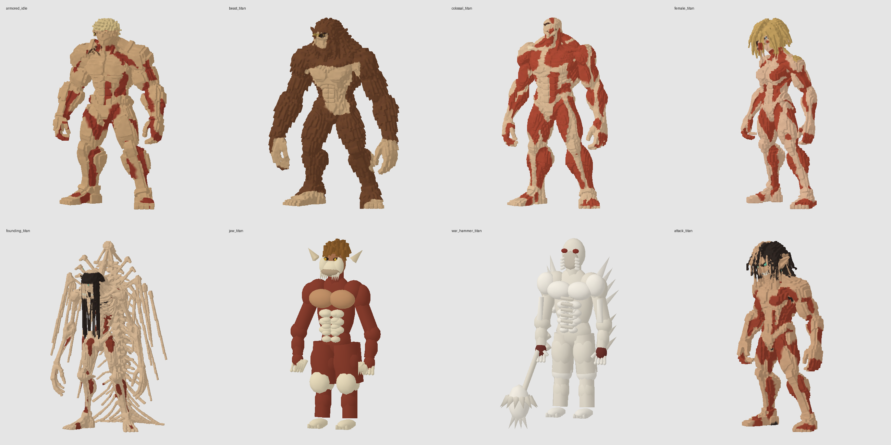
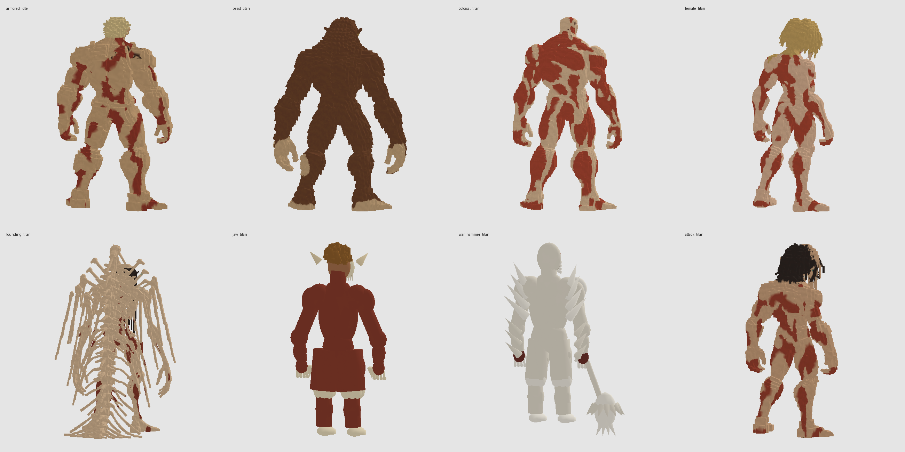

# Titan reference color review

Eight Titan identities are colored using the supplied pictures. The nine GLBs
include both the standing and animated Armored Titan.





## Scope and limits

- Armored: tan plates, red muscle, pale hair and amber eye detail.
- Beast: brown fur, exposed beige chest, face, hands and feet.
- Colossal: red muscles, pale tendons, ribs and face structure.
- Female: blond hair, beige skin, red muscle, blue eye detail.
- Founding: beige bones, dark hair, red tissue and green eye detail.
- Attack: dark hair, tan skin, red tissue, pale teeth and green eyes.
- Jaw: brown mane, ivory jaw/claws and amber eyes on the existing placeholder.
- War Hammer: ivory body/weapon and dark red tissue/eyes on the existing placeholder.

Jaw and War Hammer are substantially simpler than the reference geometry. These
are color edits of the available assets, not replacements for the missing detailed
versions. Cart is unchanged because no Cart reference was supplied.

Reference-guided projection is approximate. Mesh-aware smoothing reduces color
spill, with face, hair and rear-surface corrections. Some anatomical boundaries
can still benefit from artist refinement. The single-view references do not
define the backs; rear materials are inferred. No geometry has been remodeled,
and no new rigging is claimed.

## Review locally

Run `npm run dev` and open `/titan-studio.html` at the reported local address.
The studio displays all eight identities plus Armored's running asset. Drag a
model to orbit or use the front/side/back selector. It loads the GLBs directly,
independently of game lighting and movement. The studio is a development page.

The PNGs here are offline software renders of the actual exported geometry and
colors. They are not generated concept art or screenshots of a browser session.
Browser UI access was declined by the tool permission gate, so browser interaction
and a live game playthrough were not verified.

## Validation

- `npm run verify`: existing game verification suite plus the new asset checks.
- `npm run build`: production build.
- `python scripts/verify_titan_preservation.py`: equivalent original indices,
  positions, existing normals, UVs, joint weights and animation arrays.
- `tests/titan-reference-colors.test.mjs`: actual GLTFLoader parsing, embedded
  colors, nonmetallic materials, matched Armored standing/running colors,
  skeleton/clip presence, embedded PNGs and placeholder root orientation.

Native animation data is preserved. Its deformation is not visually reviewed in
a browser, and existing automatic skinning quality is unchanged.

## Rebuild

From the repository root:

```sh
python -m pip install -r scripts/titan-colors-requirements.txt
python scripts/color_titan_references.py
python scripts/titan_asset_tools.py artifacts/titan-color-review/after
python scripts/verify_titan_preservation.py
```

The original pictures are in `references/`. `reference-cameras.json` and
`head-landmarks.json` record the inspected body projections and head alignment.
To fit new body projections, remove the relevant entries from the camera JSON
and run `python scripts/fit_titan_references.py`. Eye landmarks were manually
selected on the source geometry; replacement geometry needs new landmarks.

Source baseline: `229e52f71d5ab5fb595aa5da03bf34bef635fe4d`.
